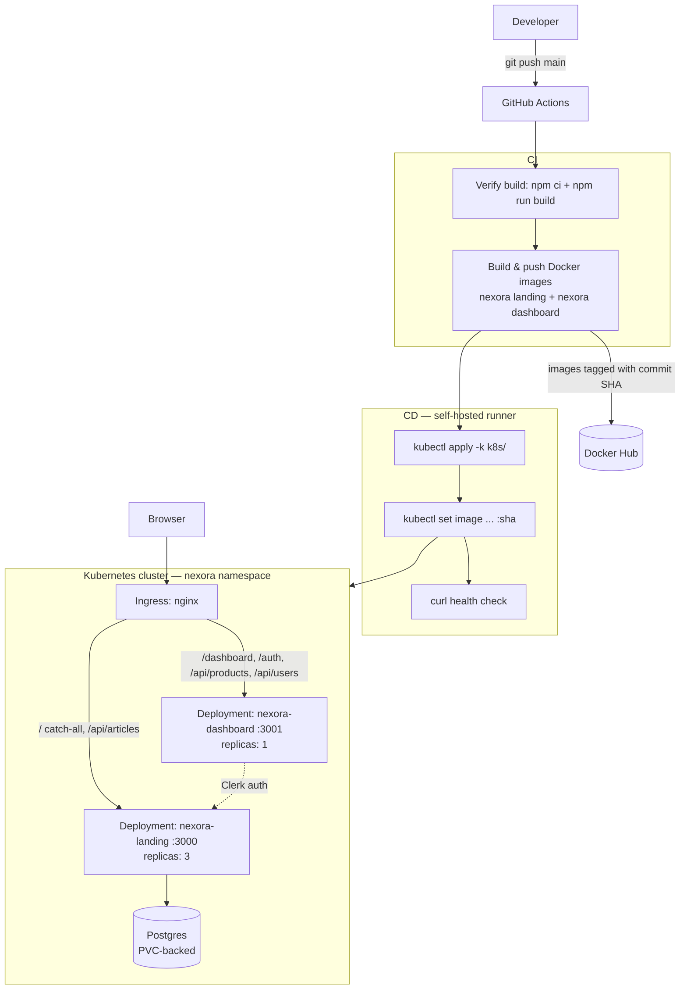

# Nexora

Nexora is a two-application SaaS product: a public **landing page and blog** and a separate, authenticated **CMS dashboard** used to manage that content. Both are Next.js apps, backed by a shared Postgres database, and deployed together to Kubernetes via a fully automated CI/CD pipeline.

## Architecture



**Request routing** is path-based, handled entirely by the Ingress — there is no reverse proxy container in production:

| Path | Routed to | Purpose |
|---|---|---|
| `/`, everything else | `nexora-landing` (:3000) | Public landing page and blog |
| `/api/articles` | `nexora-landing` (:3000) | Article data, reads/writes Postgres directly |
| `/dashboard`, `/auth` | `nexora-dashboard` (:3001) | CMS UI and Clerk sign-in/sign-up |
| `/api/products`, `/api/users` | `nexora-dashboard` (:3001) | CMS API routes |

**Why two apps instead of one**: the dashboard is a full admin/CMS surface (auth, tables, forms, role-gated actions) with its own dependency footprint, while the landing page is a lightweight public site that needs to stay fast and mostly static. Splitting them means the public site's image, scaling, and blast radius are independent of the admin panel's.

## Repository structure

```
nexora/
├── src/                  # Landing page + blog (Next.js app, served on :3000)
│   └── app/api/articles  # Articles API — the only backend code in the landing app, talks to Postgres directly
├── dashboard/            # CMS admin app (separate Next.js app, served on :3001)
│   └── src/features/     # One folder per admin feature: articles, products, users, auth, kanban, etc.
├── k8s/                  # Kubernetes manifests applied by CI/CD (source of truth for production)
│   ├── 00-namespace.yaml
│   ├── 01-configmap.yaml
│   ├── 02-secrets.yaml.template   # Never committed with real values — see Environment variables
│   ├── 03-postgres-pvc.yaml
│   ├── 04-postgres.yaml
│   ├── 05-nexora-landing.yaml
│   ├── 06-nexora-dashboard.yaml
│   └── 07-ingress.yaml
├── nginx/, docker-compose.yml     # Local-only alternative stack (see below) — not used in production
├── docs/operations.md   # Diagnostics, rollback, runner management
└── .github/workflows/ci-cd.yml
```

## Local development

Two ways to run this locally, depending on what you're working on.

**Fastest iteration — run an app directly (no Docker, no Postgres needed for UI-only work):**

```bash
npm ci
npm run dev          # landing page, http://localhost:3000

cd dashboard && npm ci && npm run dev   # dashboard, http://localhost:3001
```

**Full stack, closer to production** (landing + dashboard + Postgres + Nginx in front, mirroring the path routing the Ingress does in production):

```bash
docker compose -p nexora up -d --build
```

Open [http://localhost](http://localhost). Useful commands:

```bash
docker compose -p nexora ps
docker compose -p nexora logs -f
docker compose -p nexora down
```

Note: this Compose stack exists purely for local development convenience. Production runs on Kubernetes (see below); the two are configured to behave the same way at the routing level, but Compose is never deployed anywhere.

## Environment variables

Real values are never committed. Locally, copy `.env.example` and fill it in; in production they're injected via the Kubernetes `Secret` created from [`k8s/02-secrets.yaml.template`](k8s/02-secrets.yaml.template).

| Variable | Used by | Purpose |
|---|---|---|
| `DATABASE_URL` | landing | Postgres connection string for the articles API |
| `POSTGRES_USER`, `POSTGRES_DB`, `POSTGRES_HOST`, `POSTGRES_PORT` | postgres, landing | Database connection parameters (non-secret, in the ConfigMap) |
| `POSTGRES_PASSWORD` | postgres | Database password |
| `CLERK_SECRET_KEY` | landing, dashboard | Server-side Clerk authentication |
| `NEXT_PUBLIC_CLERK_PUBLISHABLE_KEY` | dashboard (build-time) | Client-side Clerk key, baked into the image at build |
| `NEXT_PUBLIC_CLERK_SIGN_IN_URL`, `..._SIGN_UP_URL`, `..._AFTER_SIGN_IN_URL`, `..._AFTER_SIGN_UP_URL` | dashboard | Clerk redirect routing |

## CI/CD pipeline

Defined in [`.github/workflows/ci-cd.yml`](.github/workflows/ci-cd.yml), three stages in sequence:

1. **Verify** (GitHub-hosted runner): `npm ci` + `npm run build` — fails fast on any build-breaking change, on every push and PR to `main`.
2. **Build & push** (GitHub-hosted runner, parallel matrix): builds the landing and dashboard Docker images independently, tags each with both `latest` and the commit SHA, pushes to Docker Hub. Only runs after Verify succeeds.
3. **Deploy** (self-hosted runner on the target Ubuntu/Kubernetes host, `main` pushes only): applies `k8s/` via Kustomize, then `kubectl set image` rolls both deployments to the new commit-SHA-tagged image, then health-checks the site over HTTP.

Deploying by commit SHA (not just `latest`) is what makes rollback possible — see [docs/operations.md](docs/operations.md#rollback).

The self-hosted runner is installed as a system service on the target host, so it survives reboots without manual restart.

## Operations, security, and rollback

See [docs/operations.md](docs/operations.md) for diagnostics commands, runner management, and how to roll back a bad deploy.
